# FreePlay

Custom firmware for the Polyend Play and Play+. **Version 0.1 beta.**

FreePlay adds a proper sample slicer, two LFOs with a modulation matrix, sustain and release on samples, a moving playhead, MIDI CC presets and a lot of smaller things I wanted on my own Play+. On the Play+ it's called FreePlay Plus. It's the same project.

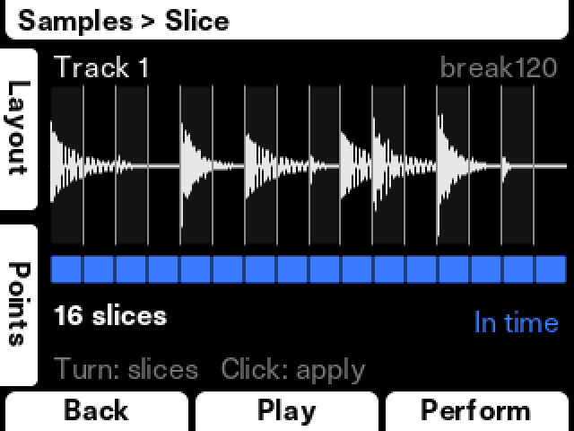

## Read this first

**This is beta firmware.** It changes the software running on your instrument, and it will have bugs. Back up your projects before you flash it, and don't install it right before a gig.

**This is not made or supported by Polyend.** Please don't take FreePlay problems to Polyend support. Report them [here](../../issues) instead.

**It will not work on every original Play.** Polyend built the original Play with two different processors, and FreePlay only runs on the one called RT.

| Your device | Firmware it needs | Does FreePlay work? |
|---|---|---|
| **Play+** | 1.3.0 | Yes. I use it on my own Play+. |
| **Original Play, RT processor** | 1.6.0 | It should, but so far it has only run on a virtual Play, never a real one. If you try it, I'd really like to hear how it went. |
| **Original Play, K66 processor** | | **Not yet.** This version is still in progress. |

**Not sure which Play you have?** There's no way I know of to tell from the outside. Install FreePlay as described below, then open *Menu → Samples*. If there's a *Slice* row, you have an RT unit. If there isn't, you probably have a K66 and FreePlay shouldn't have changed anything. Flash the official firmware to be safe, and please [tell me](../../issues), because those reports help the K66 version along.

You can always go back. See [Going back to the official firmware](#going-back-to-the-official-firmware).

## What's in it

- [Slicer](#slicer): pick a track, choose how many slices, choose where they land, done
- [LFOs and Matrix](#lfos-and-matrix): two LFOs, with separate amounts for every track and parameter
- [Moving playhead](#moving-playhead): see where the sample is as it plays
- [Sustain and Release](#sustain-and-release) on samples
- [Sample Start / End editor](#sample-start--end-editor) with a real waveform
- [MIDI CC presets](#midi-cc-presets): save your own, or load one of 43 synths
- [Better knob pages](#better-knob-pages): VU meter, keyboard, filter curve, envelope, and preset lists on Shift
- [Folder colours](#folder-colours) for your sample pool and step pads
- [Smaller things](#smaller-things): tap tempo, faster encoder, screen brightness, deleting projects and more

## The controls this guide talks about

Most FreePlay screens use the same few controls:

- **The two keys left of the screen.** White tiles along the left edge of the screen show what they do right now. Hold Shift and some of the tiles change.
- **The encoder**, the big knob next to the screen. Turn it, or press it down to click.
- **The select pads**, the rightmost pad on each row of the grid. On FreePlay's screens, pressing one picks that row's track. The track you've picked blinks blue.
- **Back**, the left soft key under the screen. It always takes you out of where you are.

## How to install

This takes about five minutes. You'll need your Play or Play+, its SD card, and a computer that can read the card. There's nothing to install on your computer.

FreePlay isn't shared as a ready-made firmware file, because that would mean giving out Polyend's firmware along with it. Instead, you download the official firmware yourself, and the installer page adds FreePlay to it.

### Step 1: Back up your SD card

Put the card in your computer and copy everything on it to a folder on your computer. Your projects are in the `Projects` folder. FreePlay isn't meant to touch them, but it's beta, and a backup costs you nothing.

### Step 2: Get the official firmware

Download the official firmware for your device from [polyend.com](https://polyend.com). It has to be exactly this version, and the installer will refuse any other:

- Play+: **1.3.0**, a file called `PlayPlus_v1.3.0.ppf`
- Original Play: **1.6.0**, a file called `PolyendPlay_v1.6.0.ppf`

### Step 3: Open the installer and drop the file on it

**[Open the FreePlay Installer](https://sloppyjoo.github.io/freeplay/)**

Drag your firmware file onto the page, or click to choose it. The page checks that it's the exact official file, adds FreePlay, then checks the result matches the build I tested, byte for byte. Your file never leaves your computer: all of this happens inside the browser tab.

Click **Save** to download your new file:

- Play+: `PlayPlus_FreePlay_01.ppf`
- Original Play: `PolyendPlay_FreePlay.ppf`

Don't rename it. The device only lists firmware files whose names it recognises.

If the page says it doesn't know your file, you have a different version or the download was damaged. Download it again.

### Step 4: Copy both files to the SD card

Copy **both** files into the `Firmware` folder on the card, the new FreePlay file and the official one. Keep the official one there, because it's your way back.

Then **eject the card properly** before you pull it out (on a Mac, click the eject symbol in Finder; on Windows, use *Safely Remove Hardware*). Pulling it out without ejecting can leave a damaged file on the card, and damaged firmware is the last thing you want to flash.

### Step 5: Flash it

1. Put the card in your device and turn it on.
2. Go to *Settings → Firmware → Update Firmware*.
3. Pick the FreePlay file and confirm.
4. The screen shows *Updating firmware, please do not power off*. This takes about 30 seconds. **Don't turn the device off or pull the card out while it's up.** When it's finished, the device restarts by itself.

### Step 6: Check it worked

Go to *Settings → Firmware* and look at the version. It should mention FreePlay. Your Menu should now have **LFO** and **Matrix** rows, and *Samples* should have a **Slice** row.

### Prefer the command line?

The same patcher is available as a Python script, if you'd rather not use a browser. Download this repository, then run:

```
python3 patcher/freeplay_patch.py PlayPlus_v1.3.0.ppf
```

## Going back to the official firmware

Flash the official file the same way you flashed FreePlay: *Settings → Firmware → Update Firmware*, then pick `PlayPlus_v1.3.0.ppf` or `PolyendPlay_v1.6.0.ppf`.

**If the device won't start up properly,** use the reset button. It flashes whatever firmware it finds in the `Firmware` folder, as long as there's only one file:

1. Take the card out and put it in your computer.
2. In the `Firmware` folder, leave only the official firmware file (`PlayPlus_v1.3.0.ppf` or `PolyendPlay_v1.6.0.ppf`). Delete any other firmware files, or move them somewhere else on your computer.
3. Eject the card properly and put it back in the device.
4. Press the small reset button on the back of the device. It installs the official firmware from the card.

FreePlay only changes the main application. It doesn't touch the bootloader, the small program that does this reinstalling, which is why this works.

## Slicer

Chop a sample across a track, without holding any steps first. Go to *Menu → Samples → Slice*.


**1. Pick the track.** Press the select pad of the row you want. It blinks blue. If the track already has trigs, you'll see the sample they play. If it doesn't, the screen tells you, and the top key (**Sample**) opens a list of your loaded samples. To change the sample later, hold Shift and press the top key.

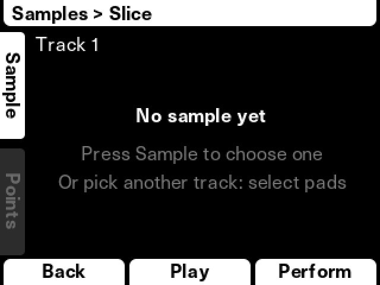

**2. Set the number of slices.** Turn the encoder, from 2 up to 64. To look closer, hold Shift and turn the encoder to zoom. While zoomed in, turning the encoder scrolls along the waveform. Zoom back out to change the slice count again.

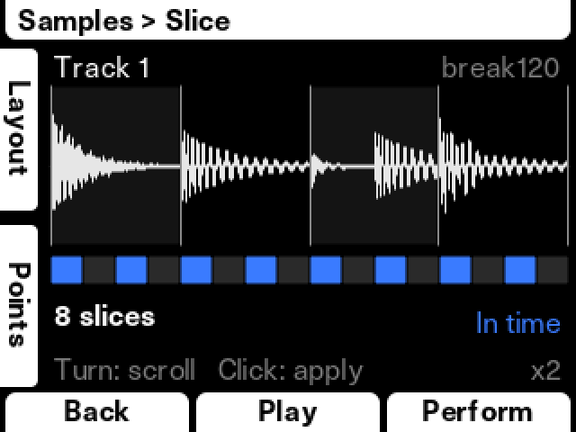

Want the cuts exactly on the hits? Press the bottom key (**Points**). Turn the encoder to move the white line, and click to add or remove a cut. The top key deletes the nearest cut, or all of them with Shift. Press **Done** when you've finished.

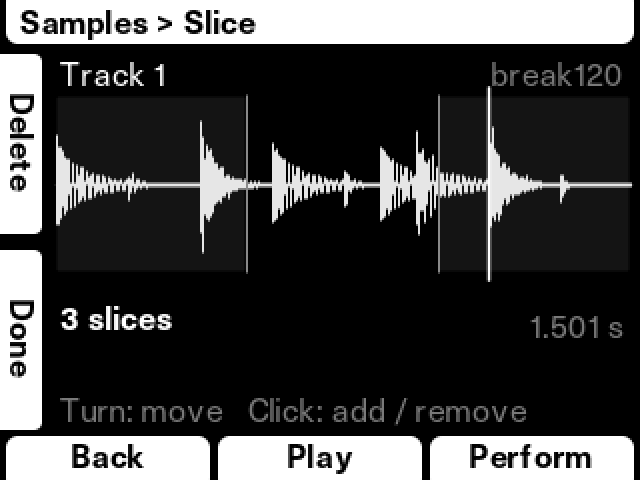

**3. Choose where the slices land.** The top key (**Layout**) switches between three options. The blue squares under the waveform and the step pads on the grid show you the result before anything changes.

| Layout | What happens | Good for |
|---|---|---|
| **In time** | Each slice lands on the step where it sits in the sample. Play it back and you get your loop again, ready to rearrange. | Breaks and loops |
| **Every step** | Slice 1 on step 1, slice 2 on step 2, and so on. | Chopping things up from scratch |
| **My trigs** | Your trigs stay where they are and get the slices in order, starting over if there are more trigs than slices. | A rhythm you've already programmed |

In time and Every step **replace the trigs already on that track**. It's one undo step, so Undo brings them all back.

**4. Apply.** Click the encoder. The screen stays open, so you can press Play, listen, change something and apply again. Back leaves.

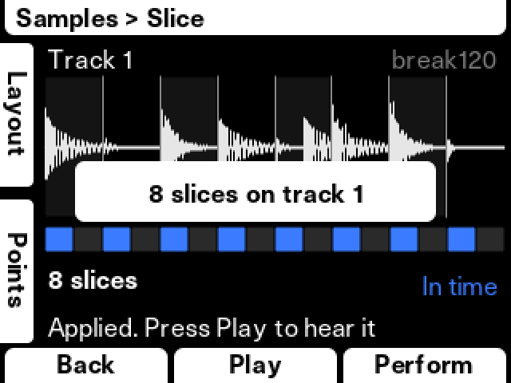

**Tip:** In time assumes the sample is the same length as the track. A 2-bar loop on a 16-step track lines up as long as the tempo matches the loop.

**Slices as separate samples:** hold Shift and click the encoder. Each slice is saved as its own sample in a new folder, and each step plays its own sample. This writes to the SD card and takes a moment, but you can then treat every slice like any other sample.

## LFOs and Matrix

Two LFOs that can move almost anything on a sample track.

**Each LFO has its own amount for every parameter on every track.** So LFO 1 can sweep the filter on track 1 and move the pan on track 3 at the same time, and LFO 2 can work on the same filter if you want. If both are on the same thing, they add together.

### Setting up an LFO: Menu → LFO

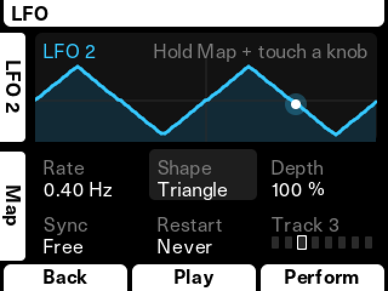

The top key switches between LFO 1 and LFO 2. Turn the encoder to move between the settings, click to take one, turn to change it, and click again to let go.

| Setting | What it does |
|---|---|
| **Rate** | How fast it moves, from 0.05 to about 47 Hz. With Sync on Tempo, this becomes musical lengths from 8 bars to 1/32. |
| **Shape** | Sine, Triangle, Ramp Up, Ramp Down, Square, Random or Drift (a smoother random). |
| **Depth** | A master amount for this LFO. Turning it down shrinks everything it's mapped to. |
| **Sync** | Free runs at its own speed. Tempo follows your project. |
| **Restart** | Never lets it run on. With Play restarts it each time you press Play. |

### Mapping it: pick a track, then turn knobs

1. Press the select pad of the track you want. It blinks blue.
2. Hold the **Map** key (the bottom key) and touch or turn a knob. That knob's parameter is now mapped to this LFO on this track, at amount 50.
3. Keep turning the knob to set the amount. Go past zero to turn the LFO upside down.

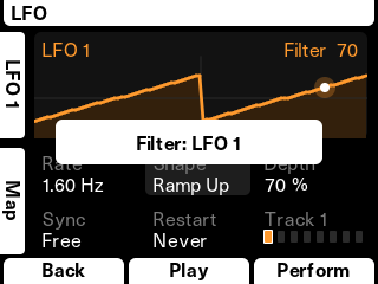

That's it. Press Play and listen. Hold Shift as well to reach the knob's second parameter, like Resonance on the Filter knob. To remove a mapping, hold Map, touch the knob and let go.

### Seeing it all: Menu → Matrix

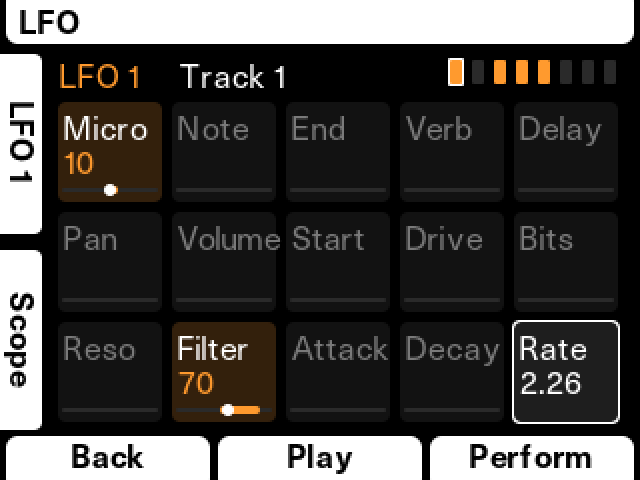

The Matrix is a grid laid out like the 15 knobs on your device, and **each knob controls its own square**. While you're on this screen, the knobs do nothing else, until you press Back.

| | | | | |
|---|---|---|---|---|
| Microtune | Note | Sample End | Reverb | Delay |
| Pan | Volume | Sample Start | Overdrive | Bit Depth |
| Resonance | Filter | Attack | Decay | LFO Rate |

Prefer the encoder? Turn it to move between squares, click to take one, turn to change it, and click again to confirm. Shift + click clears a square. The top key switches between LFOs, and the select pads switch tracks.

The boxes at the top right show the tracks: a lit box means this LFO is moving that track, and a white frame marks the track you're editing. To edit several tracks at once, hold one select pad and tap the others. Shift + select pad picks all of them.

### Seeing the LFO work

Open a parameter's knob page and you'll see it moving: the filter curve sweeps, the volume and pan bars move, and the row says **LFO**. This follows the track you touched last.

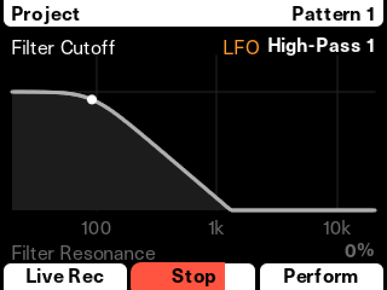

**Good to know:**
- LFOs work on sample tracks only for now.
- Filter, Volume, Pan and the other sound parameters move continuously. Sample Start, Sample End, Attack and Decay change at the start of each note.
- Your LFO settings are saved with your project. *Save Project As* starts the new copy from the defaults, so you'll need to set them up again there.

## Moving playhead

An amber line shows where the sample is as it plays, in the Start / End editor, the Slicer and Points. The Attack / Decay page shows it on the envelope too.

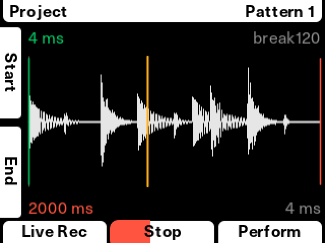

## Sustain and Release

Turn the **Attack / Decay** knob to see the envelope. Hold Shift, and the two text rows change to **Sustain** and **Release**. The envelope stays on screen so you can watch it change. Shift + top or bottom key picks one, and Shift + encoder or the same knob sets it.

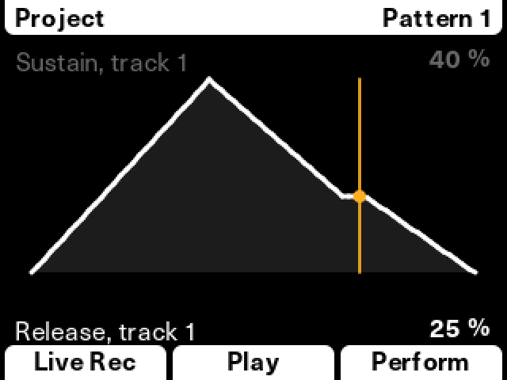

- **Sustain** is the level the sound falls to after the Attack, over the time set by Decay. Off, the default, behaves exactly like the official firmware.
- **Release** fades out the last part of the sample.

These are set per track, for the track you touched last. Sample tracks have no "key released" moment, so Release always works from the end of the sample, and not from when a note stops. Sustain levels follow the same curve as the Volume knob, so 30% sounds like the Volume knob at 30%.

## Sample Start / End editor

Turn the **Sample Start / End** knob and the numbers become a waveform. Turn the encoder to move the cursor, then use the top key to set Start there and the bottom key to set End. Shift + encoder zooms. Set End before Start and the sample plays in reverse, like the official firmware.

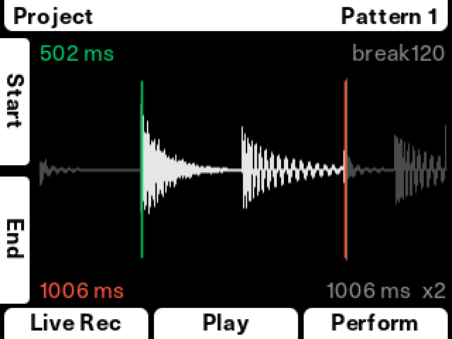

## MIDI CC presets

If you sequence an external synth, you've probably typed the same CC numbers into *MIDI → CC Mapping* more than once. Now you don't have to.

Go to *Menu → MIDI → CC Mapping*, pick a channel, and scroll to the bottom of the list:

- **Load Preset** lists your own presets, then 43 synths. Pick one and the channel's 8 CC numbers are filled in.
- **Save Preset** stores the channel's numbers in one of 8 slots, which every project can use.

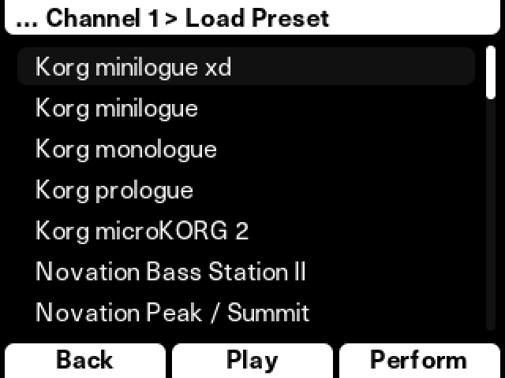

Korg, Novation, Arturia, Moog, Sequential, Oberheim, Roland, Behringer, Elektron, Waldorf, ASM, Modal, Dreadbox, Access, UDO and Yamaha are included. The full list, with what every slot does on each synth, is in [`cfw/presets/cc_presets.csv`](cfw/presets/cc_presets.csv).

**Good to know:**
- The Play only has 8 CC slots per channel, so each preset is my pick of the 8 most useful controls, not the synth's whole CC list.
- The slots keep their stock names. On a synth with no reverb, the "Reverb Send" slot might hold LFO rate instead. Check the list above to see what's what.
- Your synth has to be set to receive CCs. It's usually a setting like `MIDI Rx CC` or `Param Rcv`.
- I checked a sample of these against the manufacturers' manuals, but I can't test 43 synths. If one's wrong, please tell me.

## Better knob pages

Several knob pages now show something useful:

- **Master / Limiter:** a live VU meter, with a history that turns red where the limiter is working
- **Note / Microtune:** a keyboard with your note lit
- **Volume / Pan:** level and pan meters
- **Filter / Resonance:** the filter's response curve
- **Attack / Decay:** the envelope

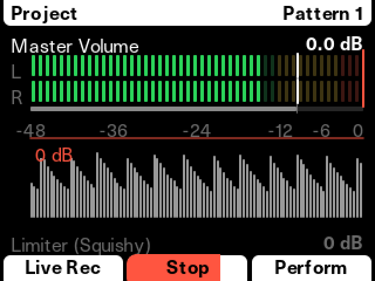

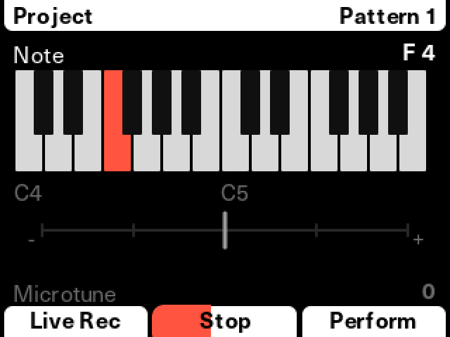

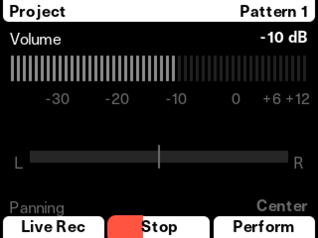

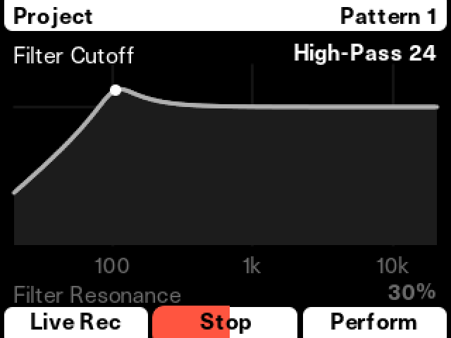

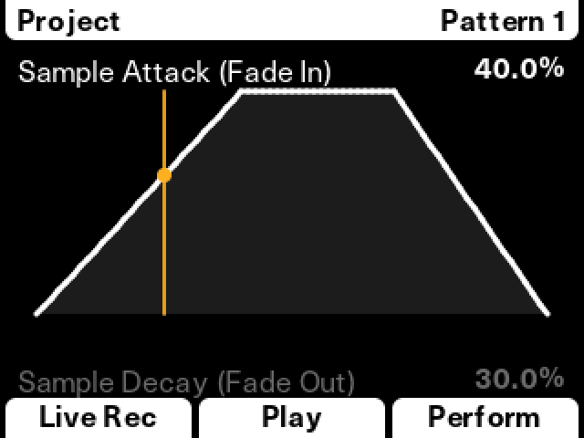

Hold Shift on these pages for presets. The tiles show what's on offer. Shift + key opens a list, and you hear each option as you turn the encoder. Click to keep it, or press Back to undo.

| Page | Shift + top key | Shift + bottom key |
|---|---|---|
| Reverb / Delay | Reverb preset | Delay preset |
| Master / Limiter | | Limiter preset |
| Overdrive / Bit Depth | Saturation type | |
| Note / Microtune | Scale | Root note |
| Tempo / Swing | Tap tempo | |

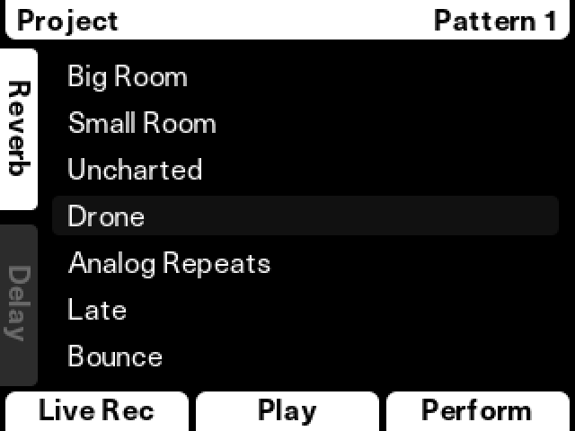

## Folder colours

In *Samples → View Sample Pool*, press the top key on a folder, turn the encoder to pick one of 10 colours, and click to set it. Step pads then light up in the colour of their sample's folder, so you can see at a glance what's playing what. White is the default, and looks the same as the official firmware.

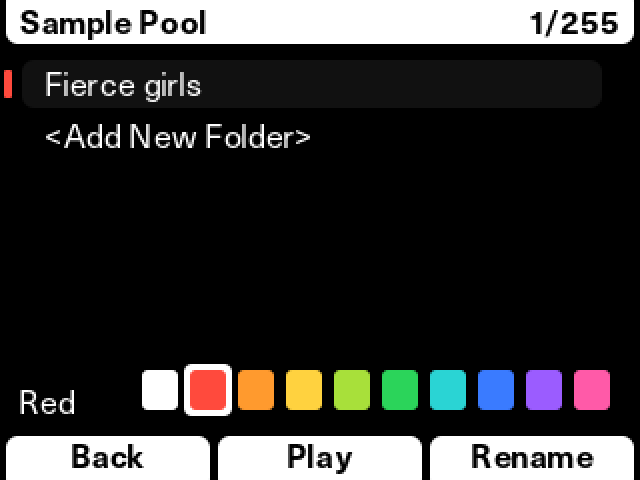

## Smaller things

- **Tap tempo:** on the Tempo page, hold Shift and tap the top key in time.
- **Faster encoder:** hold Shift while turning. It moves 10 times as far on knob pages, a full octave at a time on Note, and 5 rows at a time in menus.
- **Faster Attack and Decay:** ten times faster per click than the official firmware.
- **Screen Brightness** and **Screen Dim**, in Settings.
- **Knob Touch: Turn Only**, in Settings, so touching a knob doesn't change the page until you turn it.
- **File → Delete Project**, so you don't need a computer to tidy up.
- **Synth Randomize** on the Play+, in *Synths → (synth) → Randomize*, with undo.

## Known limits

- Nothing here has been tested on a real original Play yet.
- The original Play with the K66 processor isn't supported yet.
- LFOs, Sustain and Release work on sample tracks only.
- There's no loop point feature yet. I've tried it out and it looks possible, so it's a good candidate for a future version.
- I don't have a load meter yet, so heavy LFO use could cause audio dropouts I haven't found. If you hear any, tell me what was playing.

## Make your own version

FreePlay is open source, and I'd love to see what other people do with it. Fork it, change it, and share your own. [docs/DEVELOPING.md](docs/DEVELOPING.md) explains how to build it and test it on a virtual Play with no hardware needed, and [docs/FIRMWARE_NOTES.md](docs/FIRMWARE_NOTES.md) lists what's known about the official firmware so far. [CONTRIBUTING.md](CONTRIBUTING.md) has what would help most, including K66 support.

## Reporting bugs

Please [open an issue](../../issues) and tell me:

1. Your device: Play+, or original Play
2. What you did, what you expected and what happened instead
3. A photo of the screen, if something looks wrong

If your device froze, tell me what screen it was on and what you pressed last. There's also a [testing checklist](docs/TESTING.md) if you'd like to help test.

## For the curious: how it works

FreePlay is written in C and compiled for the device's processor. The installer adds this code to your copy of the official firmware file, and changes a small number of pointers in the original firmware so it calls the new code. Every line of the official file that FreePlay doesn't need to change stays exactly as it was. The installer page is plain HTML and JavaScript (`index.html`, `patcher/freeplay.js`), so you can read exactly what it does.

## Credits and license

FreePlay was built with a lot of help from AI (Claude, an AI coding tool), and tested on my own Play+. You'll see that in the commit history too.

CC numbers come from [MIDI Guide](https://github.com/pencilresearch/midi) by Pencil Research and its contributors, under [CC BY-SA 4.0](https://creativecommons.org/licenses/by-sa/4.0/). The preset list in `cfw/presets/cc_presets.csv` is shared under the same license.

Everything else here is MIT licensed (see `LICENSE`). Polyend, Play and Play+ are trademarks of Polyend. The official firmware belongs to Polyend and isn't included here. FreePlay isn't affiliated with or endorsed by Polyend.

Screenshots come from a virtual device, so colours may look a little different on the real screen.
